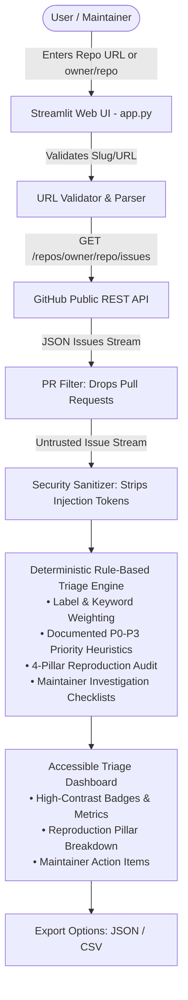

# 🛡️ RepoRelief AI

> **A lightweight, accessible, read-only GitHub issue triage assistant designed for open-source maintainers.**  
> Built for **Hacktoberfest 2026**. Fast, deterministic, privacy-first, and runs seamlessly on standard laptops (8 GB RAM, no GPU required).

---

## 📌 Problem & Proposed Solution

### The Problem
Open-source maintainers often spend countless hours sifting through incoming GitHub issues:
- **Incomplete Bug Reports:** Contributors frequently submit reports missing critical reproduction steps, operating system details, runtime versions, or tracebacks.
- **Triage Fatigue & Delay:** Distinguishing critical blockers (`P0`/`P1`) from minor cosmetic nits or questions is mentally exhausting during high-volume spikes.
- **Expensive AI Tooling & Bloat:** Most triage solutions require paid cloud AI subscriptions, API key management, external cloud hosting, or heavy GPUs.
- **Security & Untrusted Input Risks:** Issue descriptions and titles are untrusted user input that can contain prompt injections or unwanted instructions.

### The Proposed Solution: RepoRelief AI
**RepoRelief AI** delivers fast, transparent, and structured issue triage with zero API costs, zero cloud dependencies, and strict security:
1. **100% Deterministic Rule-Based Engine:** Completely transparent classification, priority ranking, and reproduction auditing. Executes in milliseconds with zero RAM bloat.
2. **Strictly Read-Only Safety:** Exclusively issues HTTP `GET` requests against public GitHub REST API endpoints (`/repos/{owner}/{repo}/issues` and `/rate_limit`). It has **zero** write capabilities—it cannot edit, label, comment on, or close issues.
3. **Anti-Prompt-Injection & Length Defenses:** Treats all issue data as untrusted text, sanitizing prompt overrides, stripping non-printable control characters, and bounding lengths.
4. **4-Pillar Reproduction Audit:** Evaluates issues against essential reproduction elements (reproduction steps, expected vs. actual outcomes, environment specifications, and code/traceback logs).
5. **Actionable Checklists:** Automatically derives a 3–5 step concrete investigation checklist for maintainers tailored to the category and priority.
6. **Accessible UI & Instant Export:** High-contrast WCAG-compliant interface with one-click export of triaged issues to JSON or CSV.

---

## 🏗️ Architecture & Data Flow



---

## 💻 System Requirements & Constraints

- **Operating System:** Windows 10/11 (fully tested in PowerShell), macOS, or Linux.
- **Hardware:** Runs on any standard laptop with 8 GB RAM and no dedicated GPU.
- **Python Version:** Python 3.10+ (tested on Python 3.11 and 3.14).
- **Cost:** **$0.00**. No paid APIs, no API keys required, and no credit card needed.
- **Network:** Uses GitHub's free public REST API (up to 60 requests/hour unauthenticated; optional free Personal Access Token unlocks 5,000 requests/hour).

---

## 🚀 Windows PowerShell Quickstart

### 1. Clone the Repository
Open Windows PowerShell:
```powershell
git clone https://github.com/rudraism19/RepoRelief-AI.git
cd RepoRelief-AI
```

### 2. Create and Activate Virtual Environment
```powershell
python -m venv .venv
.\.venv\Scripts\Activate.ps1
```
*(If PowerShell execution policy blocks scripts, run `Set-ExecutionPolicy -Scope Process -ExecutionPolicy Bypass` and retry).*

### 3. Install Dependencies
```powershell
pip install -r requirements.txt
```

### 4. Launch the Application (Zero Setup Required!)
```powershell
streamlit run app.py
```
Your browser will open automatically at `http://localhost:8501`.

RepoRelief AI works immediately out of the box using GitHub's public unauthenticated REST API. No tokens, no credentials, and no setup are needed!

*(Optional: If you are doing heavy batch triage and wish to raise GitHub's public rate limit from 60 to 5,000 requests/hour, you can optionally copy `.env.example` to `.env` and set `GITHUB_TOKEN=your_token_here`).*

---

## 🌐 Analyzing Any Public GitHub Repository (Worldwide)

RepoRelief AI is **not** restricted to predefined repositories. You can analyze **any public GitHub repository in the world** simply by entering its slug or URL into the sidebar input:

### Supported Input Formats
- `owner/repo` (e.g. `pallets/flask`, `facebook/react`, `torvalds/linux`, `rust-lang/rust`)
- `https://github.com/owner/repo` (e.g. `https://github.com/encode/starlette`)
- `https://github.com/owner/repo/issues`

### How It Works
1. **Direct Public REST API:** Issues are fetched directly using:
   ```http
   GET https://api.github.com/repos/{owner}/{repo}/issues?state=open&per_page=100
   ```
   No search API queries, token prerequisites, or personal repository permissions are ever requested.
2. **Transparent Pagination:** When requesting more than 100 issues (slider supports up to 250), RepoRelief AI automatically paginates across subsequent pages (`page=1`, `page=2`...) until the requested limit is reached or all open issues are collected.
3. **Pull Request Exclusion:** Pull requests are automatically excluded from the issue stream.
4. **Suggestions vs. Custom Inputs:** The quick-load suggestions in the UI are optional shortcuts; you can freely type any public repository name.
5. **Clear Error Diagnostics:** If an input URL is invalid, a repository is private/nonexistent (HTTP 404), or public rate limits are hit (HTTP 403), friendly diagnostic messages explain the resolution immediately.

---

## 🔍 Triage Heuristics & Confidence Model

### Priority Classification Matrix
| Priority | Definition | Trigger Heuristics |
| :--- | :--- | :--- |
| **`P0` (Blocker)** | Critical blocker, system crash, or data loss | Mentions of `segfault`, `data loss`, `data corruption`, `cve`, `vulnerability`, `rce`, `deadlock`, `kernel panic`, `unbootable`, or `critical` labels. |
| **`P1` (High)** | Major functional break or core workflow regression | `regression`, `broken workflow`, `fails to build`, `memory leak`, `crash on startup`, `performance drop`, or `blocking release`. |
| **`P2` (Medium)** | Standard bug or general feature request | General functional bugs, non-critical exceptions with workarounds, common feature enhancements. |
| **`P3` (Low)** | Cosmetic, typo, documentation, or question | `documentation`, `typo`, `spelling`, `cosmetic`, `nit`, or usage inquiry. |

### Reproduction Audit (The 4 Pillars)
RepoRelief AI checks every issue for:
1. **Steps to Reproduce:** Bulleted or numbered sequences indicating exact replication steps.
2. **Expected vs. Actual:** Clear distinction between intended and experienced behavior.
3. **Environment Details:** Operating system, Python runtime, or package versions.
4. **Code / Log Artifacts:** Formatted code blocks (`` `...` `` / ```` ```...``` ````) or stack traces.

Completeness is categorized as:
- **Complete:** 3–4 pillars present.
- **Partial:** 1–2 pillars present.
- **Missing:** 0 pillars present (flags maintainer action items).

### Transparent Confidence Reporting
Confidence is reported qualitatively as **High**, **Medium**, or **Low** based on verifiable signal strength:
- **High:** Explicit repository labels matched or multiple strong keywords in both title and body.
- **Medium:** Moderate keyword signals matched in text.
- **Low:** Insufficient keyword or label matches; categorized using safe defaults.

> [!NOTE]
> We **never** present heuristic estimates as calibrated statistical probabilities (e.g. no "98.2% probability"). Every classification is accompanied by an explicit explanation of the matched signals.

---

## ♿ Dashboard Accessibility

RepoRelief AI includes dedicated accessibility enhancements:
- **High-Contrast Badges:** Priority (`P0` Dark Red, `P1` Orange, `P2` Blue, `P3` Green) and Category badges feature solid backgrounds with high-contrast white text exceeding WCAG AA standards.
- **Accessible Privacy Banner:** Custom contrast-tuned banner with distinct border and text formatting to ensure legibility across both Light and Dark themes.
- **Structured Tabs:** Clean separation between Reproduction Audits, Actionable Checklists, and Original Issue Descriptions.

---

## 🛡️ Privacy, Security & Read-Only Guarantees

- **No Repository Mutations:** The codebase only issues HTTP `GET` requests. There are zero endpoints or methods capable of creating, editing, labeling, closing, or commenting on issues.
- **Local Data Handling:** All issue text is held in transient memory during your session. No repository contents or access tokens are sent to external cloud AI providers.
- **Untrusted Input Sanitization:** Issue titles and bodies are sanitized to neutralize prompt injection phrases (e.g., `ignore previous instructions`, `[INST]`, `### System:`) before being triaged or displayed.

---

## 🧪 Testing & Verification

The test suite contains 66 unit tests with 100% mocked network requests covering arbitrary repositories, multi-page pagination, and unauthenticated/authenticated workflows. No live GitHub credentials or network access are required to run tests.

Run the test suite in PowerShell:
```powershell
python -m pytest tests/ -v
```

### Verified Test Suites:
- `tests/test_github_client.py` (42 tests):
  - Validates parsing and fetching for arbitrary public repositories (`torvalds/linux`, `facebook/react`, `rust-lang/rust`, `kubernetes/kubernetes`, custom orgs/repos).
  - Validates multi-page pagination beyond 100 issues (e.g. 150+ issues fetching across `page=1`, `page=2` with `per_page=100`).
  - Validates pagination termination when a page returns fewer than 100 items.
  - Validates unauthenticated public API requests using `state=open` and `per_page=100` with no authorization headers.
  - Validates optional authenticated requests using Bearer tokens when configured.
  - Validates that empty strings or whitespace tokens are cleanly treated as unauthenticated requests with no authorization headers.
  - Validates handling of unauthenticated rate limits (HTTP 403), 404 Not Found, 401 Unauthorized, and network timeouts / connection failures.
  - Validates GitHub URL formats (`https://github.com/owner/repo`, `owner/repo`, SSH, trailing slashes, `.git`).
  - Rejects malicious inputs, directory traversal (`owner/../evil`), and non-GitHub hosts.
  - Verifies pull requests are strictly excluded from issue streams.
  - Verifies empty repositories and PR-only repositories return empty lists gracefully.
- `tests/test_triage.py` (24 tests):
  - Validates prompt injection sanitization and length bounds.
  - Validates deterministic category and priority heuristics across P0–P3.
  - Validates reproduction pillar auditing (Complete, Partial, Missing).
  - Validates qualitative confidence reporting.
  - Validates actionable checklist derivation for bugs, features, and docs.
  - Validates JSON and CSV export formatting and DataFrame serialization.

---

## 📸 Interface Walkthrough & Screenshot Checklist

When taking screenshots of RepoRelief AI for hackathon submissions or demos, capture the following states:

1. **Dashboard Overview:** Top KPI metrics (Total Issues, Bugs, Features, Urgent P0/P1, Missing Repro) for `pallets/flask`.
2. **Sidebar Controls:** Repository input, max issues slider, engine mode indicator, and GitHub rate limit quota meter.
3. **Issue Card Details:**
   - Color-coded high-contrast badges: Priority (`P0`–`P3`), Category, Reproduction status, and Confidence.
   - **Reproduction Audit Tab:** Visual checklist of present vs. missing contributor data.
   - **Actionable Checklist Tab:** Maintainer action items with interactive checkboxes.
4. **Export Section:** Download buttons for JSON and CSV exports.

---

## 🤖 AI-Tool Attribution

In compliance with open-source hackathon guidelines:
- **Architecture, Code & Tests:** Authored with the assistance of the Google DeepMind Antigravity AI pair programming environment.
- **GitHub Copilot:** Not used.
- **Cloud LLM APIs:** Zero paid third-party APIs used. Powered entirely by a deterministic Python engine.

---

## 📄 License

This project is licensed under the [MIT License](LICENSE).
