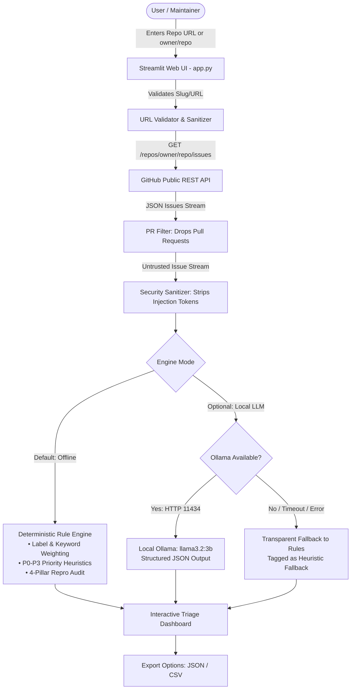

# 🛡️ RepoRelief AI

> **A lightweight, read-only GitHub issue triage assistant designed for open-source maintainers.**  
> Built for **Hacktoberfest 2026**. Fast, deterministic, privacy-first, and runs seamlessly on standard laptops (8 GB RAM, no GPU required).

---

## 📌 Problem & Solution

### The Problem
Open-source maintainers often spend hours sorting through incoming GitHub issues:
- **Missing Reproduction Information:** Contributors frequently submit reports without steps to reproduce, environment versions, or stack traces.
- **Triage Fatigue:** High issue volumes make it difficult to prioritize urgent blockers (`P0`/`P1`) over minor bugs or feature requests.
- **Resource Constraints:** Most maintainers cannot afford expensive cloud AI API subscriptions, GPU infrastructure, or complex enterprise SaaS setups.
- **Security Risks:** Issue titles and descriptions are untrusted user input that can contain prompt injections or malicious instructions.

### The Solution: RepoRelief AI
**RepoRelief AI** brings order to repository triage without costs, cloud dependencies, or security compromises:
1. **100% Read-Only Safety:** Strictly consumes public GitHub REST API endpoints (`GET /repos/{owner}/{repo}/issues`). It has **zero** write capabilities—it cannot edit, label, comment on, or close issues.
2. **Dual-Engine Architecture:**
   - **Deterministic Heuristic Engine (Default):** Instant, rule-based categorization, priority ranking, and reproduction auditing with zero RAM overhead.
   - **Optional Local LLM (Ollama):** Supports small local models like `llama3.2:3b` via Ollama for deeper semantic summarization, with automatic, transparent fallback to the rule engine if Ollama is unavailable.
3. **Anti-Prompt-Injection Defenses:** Treats all issue data as untrusted text, sanitizing prompt overrides and isolating content inside XML delimiters.
4. **Actionable Checklists:** Automatically audits issues for missing reproduction pillars and produces an immediate 3–5 step investigation checklist for maintainers.
5. **Instant Export:** Export triaged issues and checklists directly to JSON or CSV for team workflows.

---

## 🏗️ Architecture & Data Flow



---

## 💻 System Requirements & Constraints

- **Operating System:** Windows 10/11 (fully tested on PowerShell), macOS, or Linux.
- **Hardware:** Runs comfortably on an 8 GB RAM laptop without a dedicated GPU.
- **Python Version:** Python 3.10+ (tested on Python 3.11 and 3.14).
- **Cost:** **$0.00**. No paid APIs, no API keys required, and no credit card needed.
- **Network:** Uses GitHub's free public REST API (up to 60 requests/hour unauthenticated; optional free Personal Access Token unlocks 5,000 requests/hour).

---

## 🚀 Windows PowerShell Quickstart

### 1. Clone the Repository
Open Windows PowerShell:
```powershell
git clone https://github.com/Rudra-Bhullar/RepoRelief-AI.git
cd RepoRelief-AI
```

### 2. Create and Activate Virtual Environment
```powershell
python -m venv .venv
.\.venv\Scripts\Activate.ps1
```
*(If PowerShell execution policy blocks scripts, run `Set-ExecutionPolicy -Scope Process -ExecutionPolicy Bypass` and retry).*

### 3. Install Dependencies
```powershell
pip install -r requirements.txt
```

### 4. (Optional) Configure Environment
Copy the example configuration:
```powershell
Copy-Item .env.example .env
```
*(Leave `.env` untouched for default unauthenticated public access, or add a free GitHub Personal Access Token to raise rate limits).*

### 5. Launch the Application
```powershell
streamlit run app.py
```
Your browser will open automatically at `http://localhost:8501`.

---

## ⚙️ Running Modes

### Mode A: Zero-LLM Deterministic Mode (Default)
- **No setup required.** Works immediately out of the box.
- Uses documented keyword analysis, label signals, and structural markdown patterns.
- Fast execution (triages 30 issues in < 1 second).
- Zero RAM overhead; 100% offline once issues are fetched.

### Mode B: Local LLM via Ollama (Optional)
If you wish to use local generative AI for natural-language summaries:
1. Download and install Ollama for Windows from [ollama.com](https://ollama.com).
2. Pull the lightweight 3B parameter model:
   ```powershell
   ollama pull llama3.2:3b
   ```
3. Start Ollama (default port `11434`):
   ```powershell
   ollama serve
   ```
4. In the RepoRelief AI sidebar, select **"Local LLM via Ollama (Optional)"**.
5. Click **"Test Ollama Connection"** to verify connectivity.

> [!NOTE]
> **Transparent Fallback Guarantee:** If Ollama is turned off, times out, or produces invalid output, RepoRelief AI automatically falls back to deterministic analysis and labels the result as `Rule-based Heuristic (Ollama Fallback)` with the exact reason. It **never** pretends rule-based results came from an LLM.

---

## 🔍 Triage Heuristics & Confidence Model

### Priority Classification
| Priority | Definition | Trigger Heuristics |
| :--- | :--- | :--- |
| **`P0` (Blocker)** | Critical blocker, system crash, or data loss | Explicit mentions of `segfault`, `data loss`, `data corruption`, `CVE`, `vulnerability`, `deadlock`, `unbootable`, or `critical` labels. |
| **`P1` (High)** | Major functional break or core workflow regression | `regression`, `broken workflow`, `fails to build`, `memory leak`, `crash on startup`, `performance drop`. |
| **`P2` (Medium)** | Standard bug or general feature request | General functional bugs, non-critical exceptions with workarounds, common feature requests. |
| **`P3` (Low)** | Cosmetic, typo, documentation, or question | `documentation`, `typo`, `spelling`, `cosmetic`, `nit`, or usage inquiry. |

### Reproduction Audit (The 4 Pillars)
RepoRelief AI checks every issue for:
1. **Steps to Reproduce:** Bulleted or numbered sequences indicating exact replication steps.
2. **Expected vs. Actual:** Clear distinction between intended and experienced behavior.
3. **Environment Details:** Operating system, Python runtime, or package versions.
4. **Code / Log Artifacts:** Formatted code blocks (`` `...` `` / ```` ```...``` ````) or stack traces.

Completeness is categorized as:
- **Complete:** 3–4 pillars present.
- **Partial:** 1–2 pillars present.
- **Missing:** 0 pillars present (flags maintainer action items).

### Confidence Reporting
Confidence is reported qualitatively as **High**, **Medium**, or **Low** based on signal strength (e.g., repository labels vs. text keywords). We **do not** display artificial pseudo-calibrated percentages (such as "97.4% confident").

---

## 🛡️ Privacy, Security & Read-Only Guarantees

- **No Repository Mutations:** The codebase only issues HTTP `GET` requests. There are zero endpoints or methods capable of creating, editing, labeling, closing, or commenting on issues.
- **Local Data Handling:** All issue text is held in transient memory during your session. No repository contents or access tokens are sent to external cloud AI providers.
- **Untrusted Input Sanitization:** Issue titles and bodies are sanitized to neutralize prompt injection phrases (e.g., `ignore previous instructions`, `[INST]`, `### System:`) before being triaged or displayed.

---

## 🧪 Testing & Verification

The test suite contains 42 unit tests with 100% mocked network requests. No live GitHub credentials or running LLMs are needed to run tests.

Run the test suite in PowerShell:
```powershell
python -m pytest tests/ -v
```

### Verified Test Suites:
- `tests/test_github_client.py`:
  - Validates GitHub URL formats (`https://github.com/owner/repo`, `owner/repo`, SSH, trailing slashes, `.git`).
  - Rejects malicious inputs, directory traversal (`owner/../evil`), and non-GitHub hosts.
  - Verifies pull requests are strictly excluded from issue streams.
  - Verifies rate limit handling, 404 Not Found, 401 Unauthorized, and timeout recoveries.
- `tests/test_triage.py`:
  - Validates prompt injection sanitization and length bounds.
  - Validates deterministic category and priority heuristics across P0–P3.
  - Validates reproduction pillar auditing (Complete, Partial, Missing).
  - Validates qualitative confidence reporting.
  - Tests local Ollama client integration, JSON schema parsing, and transparent fallback upon network error or malformed LLM responses.
  - Validates JSON and CSV export formats.

---

## 📸 Interface Walkthrough & Screenshot Checklist

When taking screenshots of RepoRelief AI for hackathon submissions or demos, capture the following states:

1. **Dashboard Overview:** Top KPI metrics (Total Issues, Bugs, Features, Urgent P0/P1, Missing Repro) for `pallets/flask`.
2. **Sidebar Controls:** Repository input, max issues slider, engine selector, and GitHub rate limit meter.
3. **Issue Card Details:**
   - Color-coded badges: Category, Priority (`P0`–`P3`), Reproduction status, Confidence, and Engine method.
   - **Reproduction Audit Tab:** Green checkmarks vs. red crosses showing missing contributor data.
   - **Actionable Checklist Tab:** Maintainer action items with interactive checkboxes.
4. **Fallback Notification Banner:** Showing transparent fallback notice when Ollama is offline.
5. **Export Section:** Download buttons for JSON and CSV exports.

---

## 🤖 AI-Tool Attribution

In compliance with open-source hackathon guidelines:
- **Architecture, Code & Tests:** Authored with the assistance of the Google DeepMind Antigravity AI pair programming environment.
- **GitHub Copilot:** Not used.
- **Cloud LLM APIs:** Zero paid third-party APIs used. Optional local inference is powered by open weights (`llama3.2:3b` via Ollama).

---

## 📄 License

This project is licensed under the [MIT License](LICENSE).
